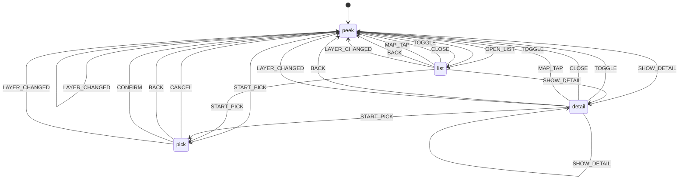
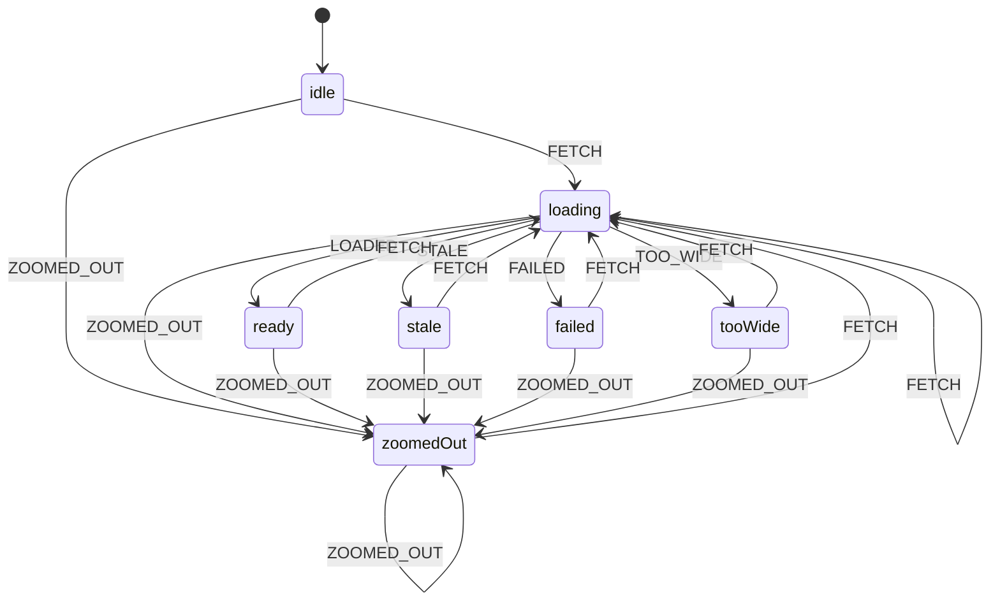
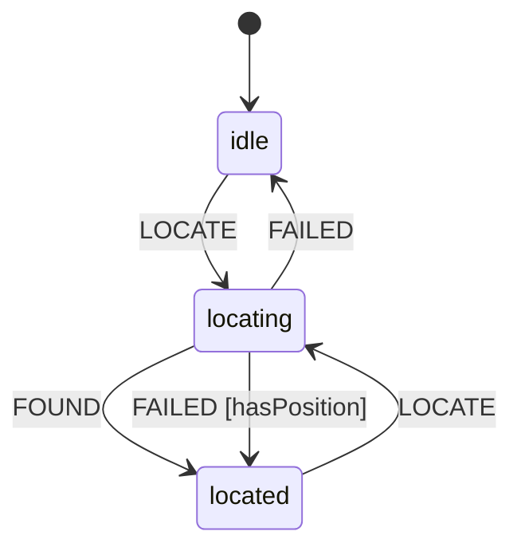

# 狀態機清單

「同一時間只能處在一種狀態」的東西，就是狀態機。以前它們散在 `app.js` 各處，用字串、布林值、計時器變數拼出來，
沒人寫下「從哪裡可以到哪裡」，所以出現過「十字準星還在，畫面卻在看詳細資料」這種矛盾。

現在的規則：
- 有兩個以上狀態、而且會被好幾個按鈕或事件改變的，定義在 `docs/js/machines.js`（純資料），`app.js` 只送事件
- 定義格式是 XState v4／`@xstate/fsm` 的設定格式；執行用 `docs/vendor/xstate-fsm`（2.6 KB，MIT），不自己寫直譯器
- 目前狀態寫在 `<body data-sheet data-load data-locate>`，也可以從 `window.__app.machines` 讀（測試和代理都用這個）
- `npm run check` 會檢查：目標狀態存在、每個狀態走得到、`app.js` 送的事件都有人處理、這份文件是最新的

## 為什麼選 @xstate/fsm（2026-11-26 比較）

| 方案 | 大小 | 定義方式 | 不用打包工具就能用 | 判斷 |
|---|---:|---|---|---|
| XState v5 | 約 2.2 MB（未壓縮套件） | 設定物件，支援巢狀、平行狀態 | 否（ESM，要打包） | 功能遠超過需要，舊手機多載一堆程式 |
| **@xstate/fsm 2.1** | **2.6 KB** | **設定物件（純資料）** | **是（UMD，`<script>` 直接載入）** | **採用**：定義可以直接讀、畫圖、在 Node 裡檢查；格式和 XState 相容，以後要升級不用重寫定義 |
| robot3 1.4 | 約 6 KB | 函式組合（`state(transition(...))`） | 只有 ESM | 定義是函式，不能當資料檢查或產生文件 |
| javascript-state-machine 3.1 | 約 13 KB | 設定物件 | 是 | 2022 年後沒有更新 |
| zag（@zag-js/core） | 約 60 KB | 設定物件 | 否 | 給元件庫用，綁框架 |

## 找到的隱含狀態機與處理方式

| # | 在哪裡 | 原本怎麼寫 | 問題 | 處理 |
|---|---|---|---|---|
| S1 | 下方面板：收合／清單／詳細資料／回報選點 | `state.sheet` 字串＋各按鈕各自 `setSheet()`；十字準星另外用 `hidden` 開關 | **[B10]** 選點時點到標記、切換圖層、拉面板，畫面換了但十字準星還留著；拉面板會跳出選點 | 狀態機 `sheet`。準星由 `pick` 的進入／離開動作負責，不論從哪裡離開都會收起；選點時不理會點標記和拉面板 |
| S2 | 畫面範圍的地點資料 | `loadSeq` 計數＋計時器＋直接呼叫 `toast` | **[B11]** 載入失敗、還在載入、範圍太大時，清單都寫「這附近還沒有資料，按 ＋ 告訴大家」，讓人以為真的沒有 | 狀態機 `load`。空清單的文字依狀態決定；`loadSeq` 保留，用來丟掉過期的回應 |
| S3 | 定位按鈕 | `async onclick`＋ `.on` class | 找位置時連按會重複要求權限；更新失敗時看不出還有沒有位置 | 狀態機 `locate`。找位置時再按不理會；更新失敗但之前有位置，就維持「已定位」 |
| S4 | 提示訊息（toast） | 一個計時器，誰都可以收掉 | **[B12]** 長按類別的「只顯示食物」提示，被地點資料載入完成時順手收掉 | 不做成狀態機（只有顯示／不顯示）；加上「誰顯示的」，收起時只收自己那則 |
| S5 | 類別長按 | 變數 `t` 有時是計時器、有時是字串 `"done"` | 能正常運作是因為重畫按鈕剛好吞掉了放開後的 click；以後改成不重畫就會壞 | 不做成狀態機（只在一個按鈕內）；改成明確的「按住中／已觸發」，已觸發時忽略接下來那次 click，並處理 `pointercancel` |
| S6 | 對話框、選單 | `hidden` 屬性 | 沒有問題：只有開／關，返回鍵由內而外關閉 | 維持原樣 |
| S7 | 回報表單：填寫／送出中／完成／改用複製／失敗 | 按鈕 `disabled`＋改寫內容 | 沒有發現問題，而且整個表單每次打開都重建 | 維持原樣；之後若加「草稿」「重試」再改成狀態機 |
| S8 | 圖層：免費資源／平價好物 | `state.layer`＋網址 `#free` `#cheap` | 切換時上一個圖層還沒回來的資料會被當成這一層的結果 | 維持字串（網址是唯一來源）；切換時讓舊請求失效 |
| S9 | 地點資料索引（`sources.js`） | Promise 快取，失敗時清掉重試 | 沒有問題 | 維持原樣 |
| S10 | 廣告程式載入 | `adsLoaded` 布林值 | 沒有問題：只會從「沒載」變「已載」 | 維持原樣 |
| S11 | 原生定位權限（`native.js`） | 先查、沒有就要求 | 沒有問題；由作業系統管 | 維持原樣 |
| S12 | 離線快取版本（`sw.js`） | `VERSION` 字串 | 沒有問題；`check.mjs` 已檢查清單 | 維持原樣 |

## 新增一個狀態機的步驟

1. 在 `docs/js/machines.js` 的 `MACHINES` 加定義（狀態、事件、進入／離開動作）
2. 在 `app.js` 用 `M.名稱 = window.startMachine("名稱", { actions, guards })` 啟動，按鈕只呼叫 `M.名稱.send("事件")`
3. 執行 `node scripts/machines.mjs` 更新下面的圖
4. 測試裡用 `<body data-名稱>` 或 `window.__app.machines` 檢查狀態（選擇器規則 12）

## 目前的狀態機

<!-- 自動產生：開始（node scripts/machines.mjs） -->

### sheet（初始：peek）

| 狀態 | 事件 | 到 | 動作 |
|---|---|---|---|
| peek | TOGGLE | list |  |
| peek | OPEN_LIST | list |  |
| peek | SHOW_DETAIL | detail |  |
| peek | START_PICK | pick |  |
| peek | LAYER_CHANGED | peek |  |
| list | TOGGLE | peek |  |
| list | CLOSE | peek |  |
| list | MAP_TAP | peek |  |
| list | BACK | peek |  |
| list | SHOW_DETAIL | detail |  |
| list | START_PICK | pick |  |
| list | LAYER_CHANGED | peek |  |
| detail | （進入／離開） | | 進入：selectPlace、離開：clearSelection |
| detail | TOGGLE | peek |  |
| detail | CLOSE | peek |  |
| detail | MAP_TAP | peek |  |
| detail | BACK | peek |  |
| detail | SHOW_DETAIL | detail |  |
| detail | START_PICK | pick |  |
| detail | LAYER_CHANGED | peek |  |
| pick | （進入／離開） | | 進入：showTarget、離開：hideTarget |
| pick | CANCEL | peek |  |
| pick | BACK | peek |  |
| pick | CONFIRM | peek | openReport |
| pick | LAYER_CHANGED | peek |  |

### load（初始：idle）

| 狀態 | 事件 | 到 | 動作 |
|---|---|---|---|
| idle | FETCH | loading |  |
| idle | ZOOMED_OUT | zoomedOut |  |
| zoomedOut | FETCH | loading |  |
| zoomedOut | ZOOMED_OUT | zoomedOut |  |
| loading | （進入／離開） | | 進入：startSlowHint、離開：stopSlowHint |
| loading | FETCH | loading |  |
| loading | LOADED | ready |  |
| loading | STALE | stale |  |
| loading | FAILED | failed |  |
| loading | TOO_WIDE | tooWide |  |
| loading | ZOOMED_OUT | zoomedOut |  |
| ready | FETCH | loading |  |
| ready | ZOOMED_OUT | zoomedOut |  |
| stale | （進入／離開） | | 進入：hintStale |
| stale | FETCH | loading |  |
| stale | ZOOMED_OUT | zoomedOut |  |
| failed | （進入／離開） | | 進入：hintFailed |
| failed | FETCH | loading |  |
| failed | ZOOMED_OUT | zoomedOut |  |
| tooWide | FETCH | loading |  |
| tooWide | ZOOMED_OUT | zoomedOut |  |

### locate（初始：idle）

| 狀態 | 事件 | 到 | 動作 |
|---|---|---|---|
| idle | LOCATE | locating |  |
| locating | （進入／離開） | | 進入：requestPosition |
| locating | FOUND | located |  |
| locating | FAILED [hasPosition] | located |  |
| locating | FAILED | idle |  |
| located | LOCATE | locating |  |

<!-- 自動產生：結束 -->
